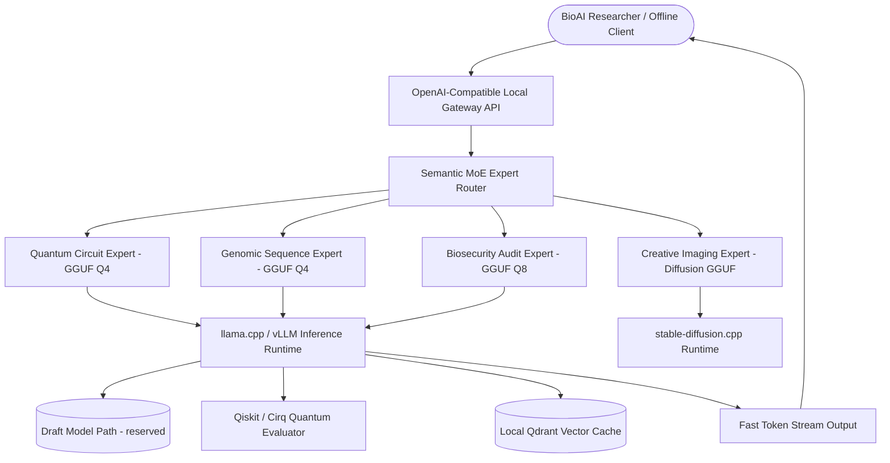

# QuantumBio-LocalMoE — Technical Specification & Operator Instructions

This document is the authoritative reference for building, configuring, deploying and
operating **QuantumBio-LocalMoE**, an air-gapped, high-throughput local Mixture-of-Experts
(MoE) reasoning engine for offline quantum-genetic sequence optimization and bio-computing
simulations. Companion UML diagrams for every component live in [`docs/uml/`](uml/).

---

## 1. System Overview

QuantumBio-LocalMoE routes user prompts to specialized local expert sub-networks before
performing inference entirely on-premise:

- **Quantum Circuit Expert** — OpenQASM/Qiskit/Cirq circuit synthesis and VQE analysis.
- **Genomic Sequence Expert** — DNA/RNA/protein sequence analysis, CRISPR-design support.
- **Biosecurity Audit Expert** — dual-use, hazard and containment screening.
- **General Reasoning Expert** — fallback for arbitrary technical queries.
- **Creative Imaging Expert** *(optional)* — local text-to-image via GGUF diffusion weights.

Every request is served through an OpenAI-compatible REST API
(`POST /v1/chat/completions`), routed in <2 ms, and executed 100% offline.
**Measured routing latency (CPU, n=231): 0.004 ms median, 0.010 ms p99** — see
[`docs/EVALUATION_REPORT.md`](EVALUATION_REPORT.md) §6.

### Top-level architecture



---

## 2. Repository Layout

```
project/
├── main.py                          # FastAPI entrypoint (uvicorn main:app)
├── Dockerfile                       # Container image build
├── docker-compose.yml               # Engine + postgres + redis + qdrant stack
├── Makefile                         # Unix/macOS orchestration
├── requirements.txt                 # Core runtime dependencies
├── requirements-optional.txt        # llama.cpp / vLLM / aer / diffusion / whisper
├── requirements-dev.txt             # Test tooling
├── .env / .env.example              # Runtime configuration
├── models/                          # Default weight directory (GGUF/AWQ)
├── outputs/                         # Generated images
├── examples/
│   ├── quickstart.py                # Async engine usage (README quick-start)
│   └── api_client.py                # OpenAI-compatible HTTP client
├── scripts/
│   ├── README.md                    # command reference (user commands + advanced ops)
│   ├── windows/                    # 14 × *.bat — setup, run, test, models, start, start_infra,
│   │                               #   build, deploy, stop, status, logs, clean, reset, smoke
│   ├── unix/                       # 14 × *.sh twins (delegated by the Makefile)
│   ├── smoke_test.py               # Endpoint smoke test
│   └── manage_models.py            # Inspect / export GGUF weights
├── quantumbio_moe/                  # Core Python package
│   ├── config.py                    # Pydantic-settings, .env reader
│   ├── engine.py                    # LocalMoEEngine orchestrator
│   ├── schemas.py                   # GenerationResponse / RouteDecision
│   ├── api/routes.py                # /v1/chat/completions, /v1/models, /health ...
│   ├── router/moe_router.py         # Semantic keyword-gate router (<2 ms)
│   ├── experts/                     # Quantum / Genomic / Biosecurity / General / Image
│   ├── inference/
│   │   ├── backends.py              # llama.cpp, vLLM, offline-heuristic, diffusion, whisper
│   │   └── registry.py              # GGUF/AWQ model discovery + classification
│   ├── quantum/circuit_info.py      # Qiskit (1.x/2.x) + Cirq bridge/simulator
│   ├── storage/                     # VectorCache (Qdrant), RedisStore, Database (asyncpg)
│   └── utils/                       # air-gap security, local hash embeddings
├── tests/                           # pytest suite (currently 45 tests)
├── evaluation/                      # T&E harness -> results/raw/*.json (see §9.1)
└── helm/quantumbio-localmoe/        # Kubernetes Helm chart
```

---

## 3. Technical Specifications

### 3.1 Inference runtime

| Property | Value |
| --- | --- |
| Primary text backend | llama.cpp (`llama-cpp-python`) for `.gguf` |
| GPU/enterprise backend | vLLM (`AsyncLLMEngine`) for AWQ/GPTQ/INT4 |
| Fallback | Deterministic offline-heuristic backend (no weights required) |
| Context window | 4096 tokens (llama.cpp), configurable per backend |
| Draft model | Smallest detected text model (reserved plumbing; speculative decoding not implemented) |
| Token counting | Whitespace heuristic (`estimate_tokens`) |
| Image runtime | stable-diffusion.cpp (`stable-diffusion-cpp-python`) |
| Audio runtime | faster-whisper / whisper_cpp (guarded import) |

### 3.2 Semantic MoE router

- Keyword gate sets per expert with domain weights (quantum 2.5×, genomic 2.0×,
  biosecurity 2.0×, image 1.5×).
- Decision = highest weighted score; measured latency **0.004 ms median / 0.010 ms p99**
  (n=231, keyword-gate scoring only) exposed in `GET /v1/route?prompt=...`.
- Intent fallback to the General Expert when no gate fires.

### 3.3 Quantum bridge

- Qiskit 1.x and 2.x compatible (`QuantumCircuit.from_qasm_str` → `qasm2.loads` fallback).
- OpenQASM validation: version, qubit count, gate count, circuit depth.
- Simulation via `qiskit-aer` when installed; VQE-style noisy-circuit evaluation via Cirq.
- All failures degrade to structured `{status, reason}` responses, never exceptions to the API.

### 3.4 Storage layer

- **Qdrant** vector cache over local hash embeddings (384-dim) with cosine search;
  transparent in-memory fallback when the service is absent.
- **Redis** TTL key/value cache; in-memory dict fallback.
- **PostgreSQL** request-log persistence via asyncpg; disabled when unreachable.
- Every adapter degrades gracefully, so the engine is fully functional air-gapped
  with **zero** external services running.

### 3.5 Air-gapped security

`utils/security.py` applies on startup:

- `HF_HUB_OFFLINE=1`, `TRANSFORMERS_OFFLINE=1` — no model/telemetry downloads.
- `WANDB_DISABLED=true`, `NO_PROXY=*` — no outbound calls.
- Torch thread control; `scrub_memory()` clears CUDA caches + GC between sessions.

---

## 4. Local LLM Integration (`LLMS` directory)

The engine scans `MODEL_DIRECTORY` plus any comma-separated extra directories in
`MODEL_EXTRA_DIRECTORIES`. On this workstation the shared model library is:

| Model file | Kind | Role |
| --- | --- | --- |
| `DeepSeek-R1-Distill-Qwen-1.5B-Q6_K_L.gguf` | Text | Primary MoE expert (reasoning) |
| `gemma-3-1b-it-Q4_K_M.gguf` | Text | Draft-capable / lightweight (reserved) |
| `Phi-3-mini-4k-instruct-q4.gguf` | Text | Alternate dense expert |
| `stable_diffusion-ema-pruned-v2-1_768.q4_1.gguf` | Diffusion | Text-to-image |
| `imgmodel_xl_q4_0.gguf` | Diffusion | High-res image expert |
| `imgmodel_ftuned_q4_0.gguf` | Diffusion | Fine-tuned image expert |
| `ggml-model-i2_s.gguf` | Diffusion | Img2img model |
| `speech.bin` | Audio | Whisper speech model |

Selection logic (`inference/registry.py`):

- **Primary**: `MODEL_NAME` if set, else largest text model.
- **Draft (reserved)**: `DRAFT_MODEL_PATH` if set, else smallest text model; used only for future
  speculative decoding — not fed to the sampler in this build (see `docs/EVALUATION_REPORT.md` §9).
- `scripts/manage_models.py list` prints the live catalog.

---

## 5. Installation

```bash
python -m venv .venv
source .venv/bin/activate            # Windows: .venv\Scripts\activate
pip install -r requirements.txt
pip install -r requirements-optional.txt   # best-effort GPU/domain extras
```

Or run the platform setup script:

- Windows: `scripts\windows\setup.bat`
- Unix/macOS: `./scripts/unix/setup.sh`
- Shortcut: `./setup.sh` / `make setup` (root shims delegate to the OS folder)

### Convenience scripts

Root mirrors **only the everyday commands** (`setup`, `run`, `test`, `models`). All
scripts live under `scripts/windows/` (`.bat`) and `scripts/unix/` (`.sh`); see
[`scripts/README.md`](../scripts/README.md) for the full reference.

| Script | What it does |
| --- | --- |
| `setup.bat` / `setup.sh` | venv + requirements + `.env` + model-catalog scan (`make setup`) |
| `run.bat` / `run.sh` | **One-click local run** — setup only if needed, optionally brings up infra, then launches the API (`make run`) |
| `test.bat` / `test.sh` | Install dev deps + run pytest (`make test`) |
| `models.bat` / `models.sh` | Wrap `manage_models.py` (`list` / `export`) (`make models`) |
| `scripts\windows\status.bat` / `./scripts/unix/status.sh` | Shows docker stack + API health check (`make status`) |
| `scripts\windows\logs.bat` / `./scripts/unix/logs.sh` | Tail the engine container logs (`make logs`) |
| `scripts\windows\clean.bat` / `./scripts/unix/clean.sh` | Stop containers, purge caches, optionally delete the venv (`make clean`) |
| `scripts\windows\reset.bat` / `./scripts/unix/reset.sh` | Full teardown (`down -v`) then setup + build + deploy (`make reset`) |
| `scripts\windows\smoke.bat` / `./scripts/unix/smoke.sh` | Wrap `smoke_test.py` (`make smoke`) |
| `scripts\windows\start.bat` / `./scripts/unix/start.sh` | Start the API only (`make start`) |
| `scripts\windows\start_infra.bat` / `./scripts/unix/start_infra.sh` | postgres/redis/qdrant via docker (`make infra`) |
| build / deploy / stop scripts | Docker image build, full-stack deploy, teardown (`make build` / `deploy` / `stop`) |

Every operation ships as a `.bat` under `scripts/windows/` and a `.sh` under
`scripts/unix/` with identical behaviour. Root-level shims (`setup.bat` / `setup.sh`,
`run.bat` / `run.sh`, `test.bat`/`test.sh`, `models.bat`/`models.sh`) delegate straight
into the correct OS folder, and Unix scripts assume `chmod +x scripts/unix/*.sh`; the
`Makefile` also delegates to them as `make run`, `make reset`, etc. See
`SUPPORTED_OS.md` for the platform matrix.

> **Windows + Python 3.13 note:** install the official CPU wheel explicitly:
> `pip install llama-cpp-python --extra-index-url https://abetlen.github.io/llama-cpp-python/whl/cpu`.
> If loading fails with *"Could not find module llama.dll (or one of its dependencies)"*,
> the MSVC OpenMP runtime (`vcomp140.dll`) is missing — copy one beside `llama.dll` in
> `site-packages\llama_cpp\lib\` or install the VC++ Redistributable. Without a loadable
> backend the engine logs a warning and uses the offline heuristic backend. On Python
> ≤3.12 or on Linux/metal hosts it works out of the box.

### 5.1 Configuration (`.env`)

| Variable | Default | Purpose |
| --- | --- | --- |
| `LOCALMOE_LOG_LEVEL` | `INFO` | Logging verbosity |
| `MODEL_DIRECTORY` | `./models` | Primary weight directory |
| `MODEL_EXTRA_DIRECTORIES` | *(empty)* | Comma-separated extra model folders (e.g. `D:/Gen AI Applications/LLMS`) |
| `MODEL_NAME` | *(empty)* | Pin the primary text model by filename |
| `DRAFT_MODEL_PATH` | *(empty)* | Reserve a light draft model path (speculative decoding not yet implemented) |
| `QUANTIZATION_TYPE` | `AWQ` | Quantization hint for vLLM |
| `DATABASE_URL` | `postgresql+asyncpg://.../localmoe` | Request-log DB |
| `QDRANT_HOST` / `QDRANT_PORT` | `localhost` / `6333` | Vector cache |
| `REDIS_HOST` / `REDIS_PORT` | `localhost` / `6379` | KV cache |
| `AUTO_CONNECT_INFRA` | `true` | Set `false` to skip infra handshakes at boot |
| `INFRA_CONNECT_TIMEOUT` | `3` | Seconds to wait when handshaking infra |
| `HOST` / `PORT` | `0.0.0.0` / `8000` | Bind address (used by start scripts) |

---

## 6. Running

### Local (no container) — one-click

```bash
run.bat / .\run.bat           # Windows: setup (if needed) + optional infra + API
./run.sh              # Unix / macOS: make run
```

Or step by step:

```bash
scripts\windows\start_infra.bat     # docker-compose up -d postgres redis qdrant (optional)
scripts\windows\start.bat           # uvicorn main:app on :8000
```

### Docker

```bash
docker-compose up -d --build        # full stack (engine + infra)
```

### Kubernetes / Helm

```bash
helm install quantumbio-localmoe ./helm/quantumbio-localmoe
```

### Smoke test

```bash
python scripts\smoke_test.py        # /health, /v1/models, /v1/route, /v1/chat/completions
```

### Tests

```bash
scripts\windows\test.bat            # or: pytest tests -v
```

---

## 7. API Reference

| Method | Path | Description |
| --- | --- | --- |
| GET | `/` | Web UI dashboard (status, model picker, system prompts, molecule builder, routing, chat, report export) |
| GET | `/health` | Liveness + engine id |
| GET | `/v1/models` | Model + expert catalog |
| GET | `/v1/route?prompt=...` | Expert routing evaluation |
| GET | `/v1/engine/models` | Deduped model catalog + active LLM path + scanned directories |
| POST | `/v1/engine/models/select` | Swap the active LLM (`{"path": ...}`); reloads via llama.cpp/vLLM |
| POST | `/v1/engine/models/scan` | Index a weights folder in-place (`{"directory": ...}`) |
| GET | `/v1/prompts` | System-prompt profile (per-expert defaults, active, overrides) |
| POST | `/v1/prompts` | Set/clear a system-prompt override (persisted to `data/system_prompts.json`) |
| POST | `/v1/chat/completions` | OpenAI-compatible chat completion (stream + non-stream, sampling params, `system` role) |
| POST | `/v1/images/generations` | Local text-to-image (diffusion GGUF required) |
| POST | `/v1/audio/transcriptions` | Local speech transcription (whisper GGUF required) |
| POST | `/v1/report/draft` | LLM-curates source output into a structured report draft |
| POST | `/v1/export` | Export content to one of `md` / `txt` / `pdf` / `pptx` |
| POST | `/v1/report/generate` | Curate + export to multiple formats in one call |
| GET | `/v1/reports` | List generated reports |
| GET | `/static/*` | Vendored JS assets (pdf.js, pptxgenjs, molecules.js) |
| GET | `/reports/*` | Served generated report files |

**Chat completion payload**

```json
{
  "model": "quantumbio-moe-local",
  "messages": [
    {"role": "user", "content": "Analyze CRISPR Cas9 target off-rate for sequence ATGCGATCGATC"}
  ],
  "max_tokens": 300,
  "temperature": 0.2,
  "stream": false
}
```

**Response**

```json
{
  "id": "chatcmpl-local-99281",
  "object": "chat.completion",
  "created": 1708170000,
  "choices": [{"index": 0, "message": {"role": "assistant", "content": "..."}, "finish_reason": "stop"}],
  "usage": {"prompt_tokens": 24, "completion_tokens": 142, "total_tokens": 166}
}
```

Set `"stream": true` to receive Server-Sent Events chunks ending with `data: [DONE]`.

---

## 8. Design Constraints & Assumptions

1. **100% offline**: all model loading is from local paths; telemetry and outbound
   traffic are disabled at syscall/HTTP level.
2. **Graceful degradation**: missing optional packages or services never crash boot —
   each subsystem falls back to a deterministic in-memory equivalent.
3. **Deterministic offline mode**: with no weights present the engine still serves
   `/health`, `/v1/models` and `/v1/chat/completions` for pipeline validation.
4. **OpenAI compatibility**: chat/image/audio endpoints mirror the OpenAI contract so
   existing enterprise tooling can point at `http://localhost:8000/v1`.

---

## 9. Component UML Reference

| Diagram | File | Scope |
| --- | --- | --- |
| Architecture | `docs/uml/architecture.puml` | System + deployment view |
| Engine | `docs/uml/engine.puml` | `LocalMoEEngine` lifecycle |
| Router & Experts | `docs/uml/router.puml` | Routing + expert model |
| Inference backends | `docs/uml/backends.puml` | Runtime abstraction |
| Model registry | `docs/uml/registry.puml` | Model discovery/classification |
| Quantum bridge | `docs/uml/quantum.puml` | Qiskit/Cirq evaluator |
| Storage | `docs/uml/storage.puml` | Vector cache + Redis + DB |
| API layer | `docs/uml/api.puml` | FastAPI routes |
| Utilities | `docs/uml/utils.puml` | Security + embeddings |
| Chat sequence | `docs/uml/sequence_chat.puml` | End-to-end completion flow |

---

## 9.1 Test & Evaluation

Measured results are reported in **[`docs/EVALUATION_REPORT.md`](EVALUATION_REPORT.md)** and
regenerated locally with `evaluation\reproduce.bat` (Windows) or `./evaluation/reproduce.sh`
(unix). Key measured values on the reference workstation (CPU-only, no Docker, no
qiskit-aer):

| Area | Measured |
| --- | --- |
| Test suite | 45 passed, 2 warnings |
| Request reliability | 705 requests, 100% success |
| Routing accuracy (n=231) | 99.13%, macro-F1 0.993 |
| Routing latency | 0.004 ms median / 0.010 ms p99 |
| Inference (CPU) | 16.3 tok/s (gemma Q4_K_M), 12.1 tok/s (DeepSeek Q6_K_L), 5.2 tok/s (Phi-3 Q4) |
| Quantum | OASM corpus validations correct; VQE-program eval reproducible 3/3; simulation unavailable (qiskit-aer missing) |
| Offline | AIR-GAPPED: 0 outbound connections, 0 telemetry URLs during startup + inference |
| Speculative decoding | Not implemented (draft stored, not passed to sampler) |
| Known defects fixed during eval | `/v1/images/generations` 500→503; `scripts/manage_models.py list` import order |

Evidence: `evaluation/results/raw/*.json` (routing, quantization, speculative, scientific,
reliability, api_extended, offline, quantum, environment) and
`evaluation/results/processed/summary.json`.

Render with PlantUML (`plantuml docs/uml/*.puml`) or `make uml`.